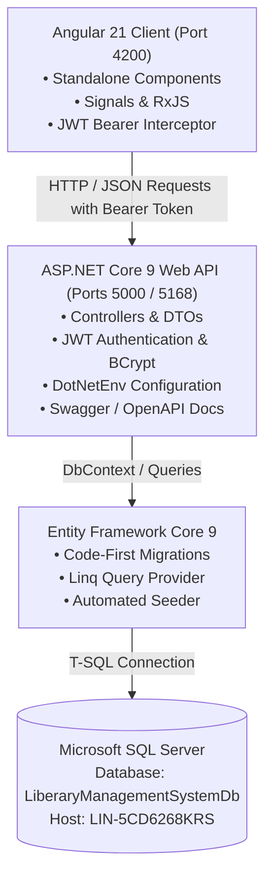

# 📚 Athena Enterprise Library Management System (LMS)

[](https://dotnet.microsoft.com/)
[](https://angular.dev/)
[](https://learn.microsoft.com/ef/core/)
[](https://www.microsoft.com/sql-server)
[](LICENSE)

A state-of-the-art, enterprise-grade **Library Management System** architected with an **ASP.NET Core 9 Web API** backend, **Entity Framework Core (Code-First SQL Server)**, and an **Angular 21** frontend designed with a modern dark glassmorphism aesthetic.

---

## 📑 Table of Contents

- [Architecture Overview](#-architecture-overview)
- [Prerequisites](#-prerequisites)
- [Project Structure](#-project-structure)
- [Environment Configuration (`.env`)](#-environment-configuration-backendenv)
- [Database Migrations & Seeding](#-database-migrations--seeding)
- [Commands to Run Backend & Frontend](#-commands-to-run-backend--frontend)
  - [1. Running the Backend API](#1-running-the-backend-api-net-9)
  - [2. Running the Frontend App](#2-running-the-frontend-angular-21)
  - [3. Running Both Concurrently](#3-running-both-simultaneously)
- [Default Demo Credentials](#-default-demo-credentials)
- [REST API Endpoints & Testing (`api-testing.http`)](#-rest-api-endpoints--testing-api-testinghttp)
- [Core Features & UI Components](#-core-features--ui-components)
- [Troubleshooting & FAQ](#-troubleshooting--faq)

---

## 🏛 Architecture Overview



### 1. Backend (`/backend`)
- **ASP.NET Core 9.0 Web API**: Scalable, high-throughput REST architecture with controller-based endpoints.
- **Entity Framework Core 9**: Code-First schema management with declarative Fluent API model relationships and migration histories.
- **SQL Server Connectivity**: Fully integrated with SQL Server instance (`LIN-5CD6268KRS`), utilizing automatic retry-on-failure resilient connections.
- **Security**: JWT token generation with HMAC SHA-256 signature, BCrypt password hashing, and role-based policies (`Admin`, `Librarian`, `Member`).
- **Configuration Security**: `.env` parsing via `DotNetEnv` keeps secrets out of hardcoded source files.

### 2. Frontend (`/frontend`)
- **Angular 21**: Built on the modern Angular standalone component architecture without legacy `NgModule` boilerplate.
- **Reactivity**: Employs Angular Signals and RxJS observables for state management and UI reactivity.
- **Design System**: Handcrafted Vanilla CSS design system with glassmorphism (`backdrop-filter: blur(16px)`), luminous badges, sleek hover animations, and dark mode palette.
- **HTTP Interceptors**: Functional `authInterceptor` automatically attaches JWT bearer tokens to all outgoing backend calls.

---

## 📋 Prerequisites

Before running the application, make sure you have the following installed on your machine:

1. **.NET SDK 9.0 or 10.0+**
   ```powershell
   dotnet --version
   ```
2. **Node.js (v18+ or v20+) & npm (v10+)**
   ```powershell
   node -v
   npm -v
   ```
3. **Microsoft SQL Server**
   - Access to instance: `Server=LIN-5CD6268KRS` (or your local SQL Server instance).
   - SQL Server Authentication enabled with user `sa` (or Windows Authentication).
4. **Entity Framework Core CLI Tools** (optional, for running manual migrations)
   ```powershell
   dotnet tool install --global dotnet-ef
   ```

---

## 📂 Project Structure

```text
Liberary-Management-System/
├── README.md                           # Documentation & Setup Guide
├── backend/                            # ASP.NET Core 9 Web API
│   ├── .env                            # Sensitive Environment Variables
│   ├── api-testing.http                # VS Code / Visual Studio REST Client Suite
│   ├── backend.csproj                  # .NET Project Configuration & NuGet Packages
│   ├── Program.cs                      # App Startup, Pipeline, Dependency Injection
│   ├── Controllers/                    # API Endpoints
│   │   ├── AuthController.cs           # Login, Register, Profile
│   │   ├── BooksController.cs          # Catalog CRUD, Search, Filter, Pagination
│   │   ├── BorrowRecordsController.cs  # Issue, Return, Overdue Tracking, Fines
│   │   ├── ReservationsController.cs   # Book Hold Reservations & Fulfillment
│   │   ├── CategoriesController.cs     # Classification Taxonomy
│   │   ├── AuthorsController.cs        # Author Biographies & Directory
│   │   ├── DashboardController.cs      # Executive Analytics & Metrics
│   │   └── UsersController.cs          # Patron & Staff Member Management
│   ├── Data/
│   │   ├── LibraryDbContext.cs         # EF Core DbContext & Entity Configurations
│   │   └── DbInitializer.cs            # Automatic Migration & Initial Seed Data
│   ├── DTOs/                           # Data Transfer Objects & Validation
│   ├── Migrations/                     # EF Core Code-First Migration Snapshots
│   ├── Models/                         # Domain Entities (Book, User, Borrow, etc.)
│   ├── Properties/
│   │   └── launchSettings.json         # Local Hosting Profiles (Ports 5000 & 5168)
│   └── Services/                       # Business Logic (JWT Auth, Audit Logging)
└── frontend/                           # Angular 21 Single Page Application
    ├── package.json                    # Angular Dependencies & Scripts
    ├── angular.json                    # Workspace Build & Style Configurations
    ├── src/
    │   ├── index.html                  # HTML Shell with Google Fonts
    │   ├── styles.css                  # Global Glassmorphic Design System & Tokens
    │   ├── environments/               # Environment Configurations (API URLs)
    │   └── app/
    │       ├── app.ts                  # Root Component with Role Switcher
    │       ├── app.html                # Header, Navigation, Footer Layout
    │       ├── app.css                 # Layout & Responsive Styles
    │       ├── app.routes.ts           # Application Routing Definitions
    │       ├── app.config.ts           # Providers (Router, HttpClient, Interceptor)
    │       ├── interceptors/           # HTTP JWT Bearer Interceptor
    │       ├── models/                 # TypeScript Domain Interfaces
    │       ├── services/               # AuthService, LibraryService, ToastService
    │       └── components/
    │           ├── catalog/            # Searchable Book Grid, Pills & Pagination
    │           ├── dashboard/          # Metric KPI Cards, Charts & Activity Feed
    │           ├── circulation/        # Circulation Desk (Loans, Returns, Fines)
    │           ├── my-loans/           # Patron Portal with Digital Library Card
    │           ├── categories-manage/  # Taxonomy & Author Management
    │           ├── book-modal/         # Create & Edit Book Dialog with Preview
    │           ├── auth-modal/         # Sign In & Registration Dialog
    │           └── toast-container/    # Dynamic Floating Toast Notifications
```

---

## ⚙️ Environment Configuration (`backend/.env`)

All critical configuration is loaded from `backend/.env` at runtime.

File path: `backend/.env`
```env
# ==========================================
# Database Connection Configuration
# ==========================================
DB_CONNECTION_STRING=Server=LIN-5CD6268KRS;Database=LiberaryManagementSystemDb;User Id=sa;Password=Capgemini@12345;TrustServerCertificate=True;

# ==========================================
# JWT Token Security Settings
# ==========================================
JWT_SECRET=CapgeminiLibrarySuperSecretKey_Min32CharsLongSecure2026!#
JWT_ISSUER=LibraryManagementSystemApi
JWT_AUDIENCE=LibraryManagementSystemClient
JWT_EXPIRY_MINUTES=1440

# ==========================================
# Server Hosting & CORS Origins
# ==========================================
PORT=5000
ALLOWED_ORIGINS=http://localhost:4200,http://127.0.0.1:4200
ASPNETCORE_ENVIRONMENT=Development
```

---

## 🗄 Database Migrations & Seeding

The application manages the database automatically. When the backend launches, `DbInitializer.InitializeAsync(context)` automatically:
1. Creates the database `LiberaryManagementSystemDb` if it does not already exist.
2. Applies any pending EF Core migrations.
3. Seeds default categories, authors, publishers, books, and users.

### Manual EF Core Commands (Optional)
If you modify models or schemas in `backend/Models/`:

```powershell
# Navigate to backend folder
cd c:\v\Liberary-Management-System\backend

# 1. Create a new migration
dotnet ef migrations add <MigrationName>

# 2. Update the SQL Server database schema
dotnet ef database update

# 3. Revert last applied migration (if needed)
dotnet ef migrations remove
```

---

## 🚀 Commands to Run Backend & Frontend

### 1. Running the Backend API (.NET 9)

Open a terminal (PowerShell or Command Prompt) and execute:

```powershell
# Navigate to backend directory
cd c:\v\Liberary-Management-System\backend

# Restore NuGet dependencies
dotnet restore

# Build the project
dotnet build

# Launch the Web API server
dotnet run --launch-profile http
```

Once running, the backend will be available at:
- **API Base URL**: `http://localhost:5000` (and `http://localhost:5168`)
- **Interactive Swagger Documentation**: `http://localhost:5000/swagger`

---

### 2. Running the Frontend (Angular 21)

Open a **separate** terminal window and execute:

```powershell
# Navigate to frontend directory
cd c:\v\Liberary-Management-System\frontend

# Install node dependencies (first time only)
npm install

# Start the Angular development server
npm start
```

Once compiled, open your browser and navigate to:
- **Frontend Application URL**: [http://localhost:4200](http://localhost:4200)

*(To generate a production build of the frontend, run `npm run build`.)*

---

### 3. Running Both Simultaneously

To start both servers concurrently in a single PowerShell session:

```powershell
# Terminal Tab 1: Start Backend
Start-Process powershell -ArgumentList "-NoExit", "-Command", "cd c:\v\Liberary-Management-System\backend; dotnet run --launch-profile http"

# Terminal Tab 2: Start Frontend
Start-Process powershell -ArgumentList "-NoExit", "-Command", "cd c:\v\Liberary-Management-System\frontend; npm start"
```

---

## 🔑 Default Demo Credentials

Pre-seeded accounts are available immediately. The frontend also includes a **1-click Quick Demo Switcher** in the top navigation bar to test all roles without typing.

| Role | Email | Password | Allowed Operations |
|---|---|---|---|
| **Administrator** | `admin@library.com` | `Admin@123` | Full control: add/edit/delete books, manage categories, activate/deactivate members, delete records. |
| **Librarian** | `librarian@library.com` | `Librarian@123` | Staff circulation: issue books, return books, collect fines, add catalog items, fulfill hold reservations. |
| **Member** | `member@library.com` | `Member@123` | Patron access: browse catalog, borrow in-stock books, place hold reservations, view digital library card. |

---

## 🧪 REST API Endpoints & Testing (`api-testing.http`)

The file `backend/api-testing.http` is pre-configured with full request bodies and automatic response token storage. Open it in Visual Studio or VS Code with the **REST Client** extension to test.

| Module | Method | Endpoint | Description | Auth Required |
|---|---|---|---|---|
| **Auth** | `POST` | `/api/auth/login` | Sign in & receive JWT token | Public |
| **Auth** | `POST` | `/api/auth/register` | Register new library patron | Public |
| **Auth** | `GET` | `/api/auth/me` | Fetch profile of signed-in user | Bearer Token |
| **Users** | `GET` | `/api/users` | List members with role filter | Admin, Librarian |
| **Users** | `PUT` | `/api/users/{id}/toggle-status`| Deactivate/activate user | Admin |
| **Dashboard** | `GET` | `/api/dashboard/stats` | KPI metrics, category counts, monthly trends | Public |
| **Books** | `GET` | `/api/books` | Search, filter, paginate catalog | Public |
| **Books** | `GET` | `/api/books/{id}` | Get book details by ID | Public |
| **Books** | `POST` | `/api/books` | Add new book to catalog | Admin, Librarian |
| **Books** | `PUT` | `/api/books/{id}` | Update existing book | Admin, Librarian |
| **Books** | `DELETE`| `/api/books/{id}` | Delete book (if not on loan) | Admin |
| **Borrow** | `GET` | `/api/borrowrecords` | List loans with status filter | Admin, Librarian |
| **Borrow** | `GET` | `/api/borrowrecords/my-history`| View logged-in member's loans | Bearer Token |
| **Borrow** | `POST` | `/api/borrowrecords/borrow` | Checkout / issue a book | Bearer Token |
| **Borrow** | `POST` | `/api/borrowrecords/return` | Check in book & calculate fines | Admin, Librarian |
| **Borrow** | `POST` | `/api/borrowrecords/pay-fine` | Settle overdue fine | Bearer Token |
| **Reservations**| `POST` | `/api/reservations` | Place hold on checked-out book | Bearer Token |
| **Reservations**| `GET` | `/api/reservations/my-reservations`| View member's holds | Bearer Token |
| **Reservations**| `PUT` | `/api/reservations/{id}/cancel`| Cancel pending hold | Bearer Token |
| **Categories** | `GET` | `/api/categories` | List categories with book counts | Public |
| **Categories** | `POST` | `/api/categories` | Create classification category | Admin, Librarian |
| **Authors** | `GET` | `/api/authors` | List world authors | Public |
| **Authors** | `POST` | `/api/authors` | Add author biography | Admin, Librarian |

---

## 🎨 Core Features & UI Components

1. **Catalog Explorer** (`/catalog`)
   - Instant search by title, ISBN, or author name.
   - Interactive category pill filters with live volume count indicators.
   - Real-time stock status badge: "X / Y Available" vs "On Loan".
   - 1-click Borrow action for members, or Reserve Hold when 0 copies remain.
   - Floating pagination controls for multi-page collections.

2. **Executive Operations Dashboard** (`/dashboard`)
   - 6 Glowing KPI Cards: Unique Titles, Shelved Copies, Active Loans, Overdue Warnings, Active Patrons, and Outstanding Fines.
   - Visual progress bars depicting category distribution percentages.
   - Bar chart depicting 6-month historical circulation velocity.
   - Audit stream of recent checkouts and returns with quick check-in shortcuts.

3. **Circulation & Loans Desk** (`/circulation`)
   - Tabbed view: `All Loans`, `Active Loans`, `Overdue Loans`, and `Returned Log`.
   - "Issue Book to Member" modal with in-stock book dropdown and member search.
   - Instant check-in logic that calculates fines automatically ($1.00 per overdue day).
   - "Collect Fine" button to settle unpaid penalty balances.

4. **Member Portal & Digital Library Card** (`/my-loans`)
   - Holographic digital library card displaying member name, role badge, unique card barcode number, and membership date.
   - Active loans list with countdown indicators and due dates.
   - Hold reservations list with status tracking and hold cancellation.
   - Lifetime borrowing history table.

5. **Taxonomy & Author Directory** (`/manage`)
   - CRUD management for book classification categories and world authors.
   - Protection against deleting categories that contain books.

---

## ❓ Troubleshooting & FAQ

### 1. Backend: "Cannot open database LiberaryManagementSystemDb"
- **Cause**: SQL Server login failed or database does not exist.
- **Solution**: The application creates the database automatically on startup if credentials in `.env` are valid. Verify that the SQL Server instance `LIN-5CD6268KRS` is running and user `sa` is enabled with password `Capgemini@12345`.

### 2. Backend: Port 5000 is already in use
- **Solution**: You can run the backend on port `5168` or configure another port in `Properties/launchSettings.json` and `.env`.

### 3. Frontend: "Cannot connect to API" / CORS Error
- **Solution**: Ensure the backend is running (`dotnet run`). Check that `ALLOWED_ORIGINS` in `backend/.env` contains `http://localhost:4200`.

### 4. Database Schema Changes
- **Solution**: If you edit any model in `backend/Models/`, run:
  ```powershell
  cd backend
  dotnet ef migrations add <YourMigrationName>
  dotnet ef database update
  ```

---

Developed for **Capgemini** | Built with **.NET 9**, **Angular 21**, and **Entity Framework Core**.
